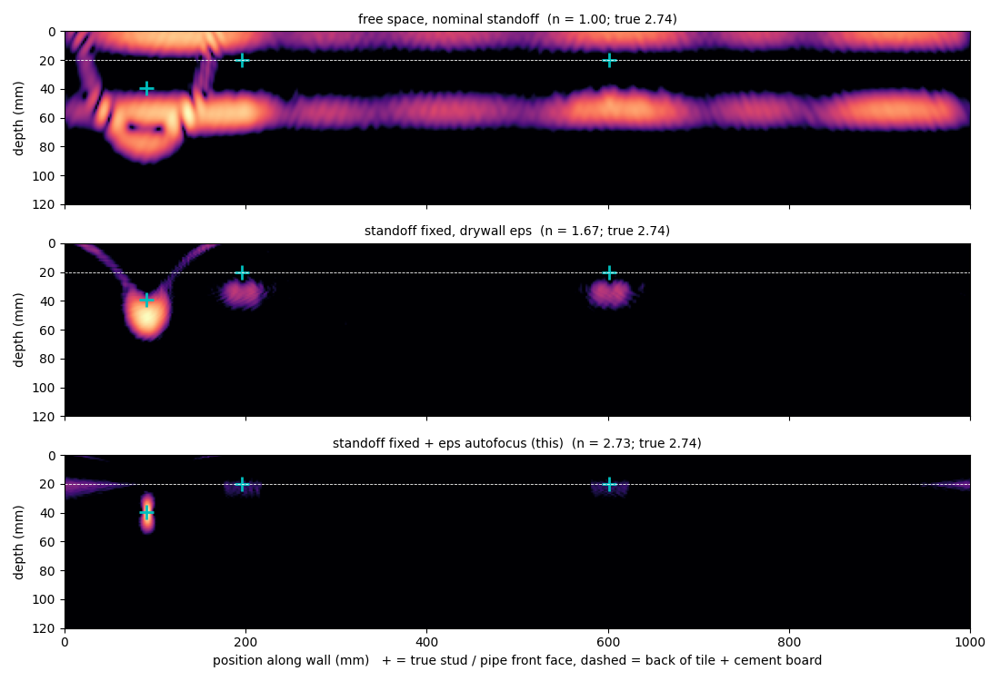

# Handheld through-wall radar imaging that stays in focus (simulation)

Unofficial prototype by Kushagra Pratap Singh. Not affiliated with Applied Electrodynamics.

Applied Electrodynamics builds a camera that sees through walls with radio waves and maps pipes and wiring "with millimeter accuracy" ([site](https://www.appliedelectrodynamics.com/), [YC](https://www.ycombinator.com/companies/applied-electrodynamics-inc)). Their next step is a handheld. Two physical effects then decide whether millimetres are real:
1. **Hand wobble.** The standoff from the wall changes by several mm during a sweep. At 4–20 GHz that is a large fraction of a wavelength, and the image smears.
2. **Wall material.** Radio slows inside the wall by n = √εr. Drywall is about 1.6; tile on cement board about 2.7; plaster in between. It varies by product and moisture. Image with the wrong n and everything behind the wall lands at the wrong depth.

This repo simulates a handheld stepped-frequency scan of real wall builds and fixes both from the radar data alone. It then answers the question a contractor actually asks: **"is it safe to drill a 45 mm hole here?"**



```
$ python demo.py
wall: tile_on_cement_board, 20.0 mm, effective n 2.74; hand wobble 6.4 mm peak-to-peak over a 1 m sweep
  free space, nominal standoff     n=1.00  cable -> x  116.0 mm, depth  60.0 mm   45 mm hole 12 mm beside it: CLEAR
  standoff fixed, drywall eps      n=1.67  cable -> x   92.0 mm, depth  52.0 mm   45 mm hole 12 mm beside it: CLEAR
  standoff fixed + eps autofocus   n=2.73  cable -> x   90.0 mm, depth  40.0 mm   45 mm hole 12 mm beside it: NOT_CLEAR
  truth: cable at x 90.7 mm, front face 39.4 mm deep -> a 45 mm hole there hits it
```

## How it works (`wallscan/`, numpy)
- **`sim.py`:**
  - 4–20 GHz stepped-frequency radar (161 steps), swept by hand along a 1 m wall in 4 mm steps;
  - smooth random standoff wobble; layered walls (drywall, double drywall, plaster on lath, tile on cement board) with εr jitter;
  - targets: studs at 16" o.c., copper and PEX pipes, cable;
  - straight-ray delay with each layer's extra optical path; front- and back-face echoes; noise.
- **`image.py`:**
  - **Standoff per position** from the wall's own front-face echo (sub-sample peak, then a continuity filter). Under 1 mm error on dev.
  - **Wall echo removal:** align every position on its front face, subtract the mean, undo the shift.
  - **Optical thickness** Σ nᵢdᵢ from the front-to-back echo delay.
  - **Autofocus over n:** backproject through one layer of thickness Σnᵢdᵢ / n and pick the sharpest image (region-size neutral).
- **`detect.py`:**
  - reflectors above 2.5× the image floor;
  - **drill check:** NOT CLEAR if a reflector could be within 10 mm sideways (+20 mm size margin) and shallower than the hole (+3 mm). Checked for 25, 35, 45 and 60 mm holes every 5 mm along the wall.

## Results
**Held-out:** 30 walls ([`heldout/config.json`](heldout/config.json)), frozen in git (commit `752ebfe`) before the first run. They include wall builds dev never saw (plaster on lath, double drywall), ±25% εr spread, more wobble (6 mm) and lower SNR (20 dB).

**First run:**

| method | targets found | depth error median / p90 | drill checks called CLEAR over a pipe, cable or stud | false NOT CLEAR |
|---|---|---|---|---|
| free space, nominal standoff | 23 / 120 | 16.9 / 33.2 mm | 3,489 / 3,679 | 152 / 18,881 |
| standoff fixed, drywall εr | 116 / 120 | 4.2 / 15.0 mm | 488 / 3,679 | 1,781 |
| **standoff fixed + εr autofocus (this)** | 111 / 120 | **1.7 / 5.0 mm** | **424 / 3,679** | 2,283 |

The first run exposed two bugs, both fixed afterwards. The after-fix numbers are no longer held-out:
1. On some walls, the front-echo picker locked onto a strong pipe echo at a few positions (up to 243 mm wrong). **Fix:** a continuity filter, since a hand moves smoothly.
2. The autofocus score was biased toward low n, because the image region behind the wall changes size with n. **Fix:** normalise by region size.

After the fixes: this method 116/120 found, depth 1.6 / 4.8 mm, **287** dangerous CLEAR calls, vs 431 for the drywall-εr method.

Dev (15 walls, used for the detection threshold): this 0 / 1,990 dangerous CLEAR vs 292 (drywall εr) and 1,943 (free space). Depth median 1.3 mm.

## Honest limits
- **Still not safe enough.** On held-out walls the drill check still says CLEAR over something 287 times out of 3,679 (8%). The misses are weak targets near studs and walls where autofocus is off. A real product would add a "not sure" answer, which this doesn't have yet. It also raises more false NOT CLEARs than the baseline (more reflectors kept).
- **2-D, straight-ray, point-scatterer simulation.** No refraction bending, no antenna coupling, no rebar or metal lath (which would block plaster-on-lath scans), and no along-wall position drift. A real handheld needs visual or IMU odometry for x, and that error is not modelled.
- **Nothing here is based on WaveSight's design.** Their band, array and algorithms are not public.

## Run
```
pip install numpy matplotlib pytest
python demo.py
python evaluate.py heldout     # ~6 min; first run kept in out/heldout_first_run.json
python -m pytest -q            # 6 tests
```
